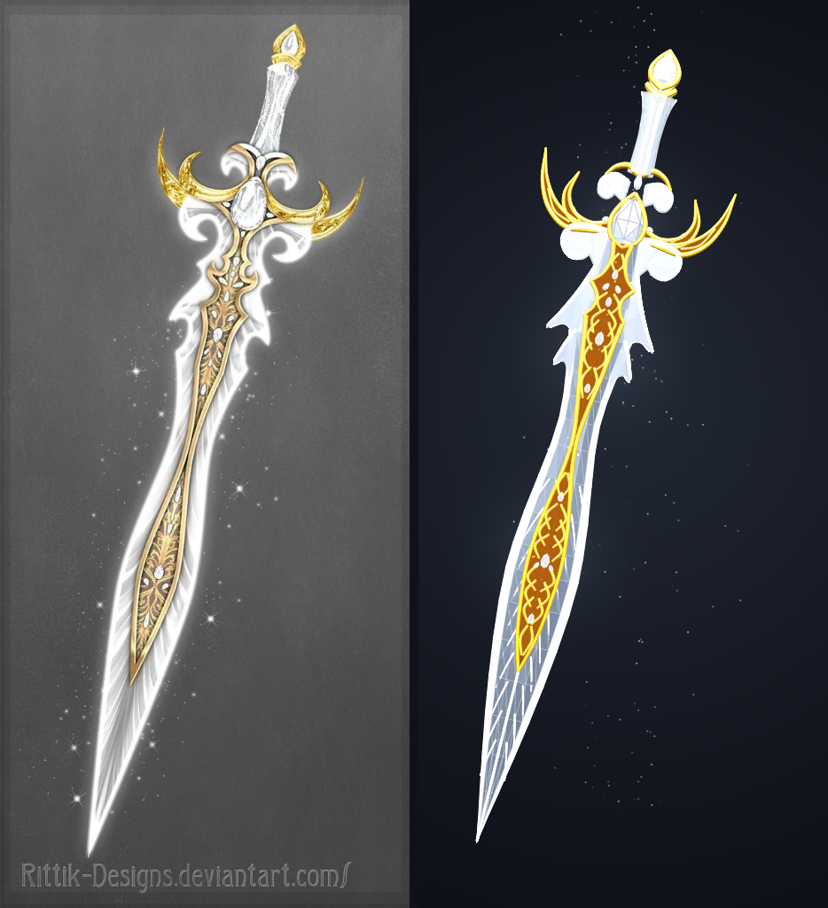

# ⚔️ Espada Divina (Divine Sword) - 3D Three.js

Modelo procedural 3D de alta fidelidade da **Espada Divina em Cristal & Ouro**, reconstruído em código procedural utilizando **Three.js**, **TypeScript** e **Vite**, inspirado na arte conceitual de *Rittik-Designs*.



---

## ✨ Funcionalidades

- **Modelagem 3D Procedural de Alta Fidelidade**:
  - Lâmina de cristal em folha com cintura estreita e bisel bicolor (prata-gelo e borda branca luminosa).
  - Guarda dupla em crescente dourado com leito em ouro antigo e bordas esculpidas em relevo.
  - Volutas espirais de cristal branco sob a guarda e sob os arcos superiores.
  - Joia central em gota (lapidação diamante pera) engastada em moldura de ouro.
  - Espinha contínua de arabescos dourados com 9 diamantes lapidados engastados ao longo do centro.
  - Empunhadura de cristal prateado acinturada com ranhuras em *chevron* e pomo em gota flamejante.
  - Sistema de 180 partículas de centelhas estelares de 4 pontas em 3D.
- **Interação 3D Completa**:
  - Rotação 360° em todos os eixos (`OrbitControls`).
  - Zoom com scroll do mouse e pan com botão direito.
  - 6 Presets de Câmera (`Perspectiva`, `Guarda & Joia`, `Lâmina`, `Pomo`, `Perfil`, `Frente`).
  - Botão de alternar referência 2D em sobreposição (*Overlay* semitransparente) para conferir a precisão métrica.
- **Renderizador Híbrido Resiliente**:
  - Suporta **WebGL nativo com pós-processamento de Bloom**.
  - Inclui motor próprio de **Software 3D em Canvas 2D** (`SoftwareRenderer3D.ts`), permitindo rotacionar o modelo 3D em tempo real mesmo em navegadores ou sistemas com aceleração gráfica/WebGL bloqueada.
- **Suporte Completo a Dispositivos Móveis**:
  - Gestos touch (1 dedo gira, 2 dedos dão zoom de pinça).
  - Layout responsivo adaptado para telas verticais de smartphone.

---

## 🚀 Como Executar Localmente

### Pré-requisitos
- Node.js (versão 18 ou superior)
- npm ou pnpm

### Instalação

```bash
# Clone o repositório
git clone https://github.com/DuardoHenrique/sword-divine.git
cd sword-divine

# Instale as dependências
npm install

# Inicie o servidor de desenvolvimento
npm run dev
```

Acesse no navegador:
👉 `http://localhost:5173/`

### Build para Produção

```bash
npm run build
```

---

## 🛠️ Tecnologias Utilizadas

- [Three.js](https://threejs.org/)
- [TypeScript](https://www.typescriptlang.org/)
- [Vite](https://vitejs.dev/)
- [lil-gui](https://lil-gui.georgealways.com/)

---

## 📜 Créditos

- Conceito da Arte Original: **Rittik-Designs** (DeviantArt)
- Reconstrução 3D & Código: **Eduardo Henrique**
